<p align="center">
  
</p>

<p align="center">
  <a href="https://github.com/GETAccretion/getaccretion.github.io/actions/workflows/build.yml"></a>
  <a href="https://github.com/GETAccretion/getaccretion.github.io/actions/workflows/ci.yml"></a>
  
  
  
</p>

In space, *accretion* is how gravity pulls scattered matter into a single body. **Accretion** does
the same for apps. It is an app source in the standard **AltStore JSON format** that pulls over a
hundred public AltStore and SideStore sources into one link. Each app appears once, at its **newest
version**. It is rebuilt every 6 hours, and broken entries and dead download links are removed
automatically.

<picture>
  <source media="(prefers-color-scheme: dark)" srcset="assets/card-dark.svg">
  
</picture>

## Browse the store

**[getaccretion.app](https://getaccretion.app/)**: search every app, filter by
category, see versions, sizes and what's new, and download or open apps in AltStore or SideStore. It is
rebuilt with the source every 6 hours. Downloading needs a free account: the website and the
Accretion app show the download and install buttons once you sign in. For third-party apps this is
only a gate in the store; their files stay at their sources and are never copied.

The store loads its catalogue from `data/store.json`, built by [`scripts/site.py`](scripts/site.py).
[`site/app-config.json`](site/app-config.json) sets `minimumVersion`, the oldest Accretion app
still supported (currently 1.0.5), and newer copies of the app enforce it. Older copies read
`data/index.json`, which lists only the Accretion app, so all they can do is update.

**Most popular** ranks apps by three signals: how many of the sources carry an app (maintainers
add what their users ask for), the apps that guides and communities name most
([`popular.txt`](popular.txt)), and anonymous searches on the store itself. Searches that find
nothing show up for moderators, so missing apps and sources can be added first.

## Sign your own apps

[`#/sign`](https://getaccretion.app/#/sign) walks through installing any app on an iPhone
with the **Accretion app**, on-device and without the 7-day limit. The Accretion app is free and
open source and built on Feather, so Feather still works the same way. Get a certificate (the
support.json certificate links), add it to the Accretion app or Feather in one tap (the page builds
the app's import-certificate link in the browser; nothing is uploaded), pick an app from Accretion
or paste any `.ipa` link, then customize it (name, bundle ID, icon, minimum iOS, file sharing,
PlugIns, tweaks) with the exact menu paths. Every app page also has install buttons and links to
the guide.

## Community

Sign in on the store or in the Accretion app (email, Google, GitHub or Discord) to download apps,
comment on them, like and rate them, follow people, and post to a shared feed. Moderators handle
reports. It runs on a free Supabase project; see [`supabase/README.md`](supabase/README.md) for
setup. Without it, the store works as before, with nothing gated.

## Accretion's own builds

The third-party apps from the merged sources (current counts in [`stats.json`](stats.json)) are only
listed and linked, never hosted.
Accretion's **own** builds are the exception: the Accretion app (`io.github.getaccretion.Accretion`)
and [Accretion Mods](https://github.com/AccretionMods/mods). Their files sit in a private Supabase
Storage bucket and are served by the Edge Functions in [`supabase/functions/`](supabase/functions):

- **download** gives a signed-in user, or the holder of a personal key, a 5-minute link to the
  file and logs the download. Anyone else who opens it in a browser is sent to the app's store page.
- **source** makes a personal copy of the Accretion Mods or Accretion app source whose download
  links go through the download server, for apps that can't sign in (AltStore, SideStore,
  Feather, ESign).
- **upload** takes new builds from the release workflows and the mods publish script.

To add those sources, open **Edit profile → Your download links** on the store and **Copy** a
link. The links are personal: anyone who has them downloads as you. **Replace key** makes new ones
and turns the old ones off. [`host-builds.yml`](.github/workflows/host-builds.yml)
([`scripts/host_builds.py`](scripts/host_builds.py)) is only a fallback that copies builds
the upload missed; new releases upload directly. See
[Private downloads](supabase/README.md#private-downloads) for the details.

## Support links

[`support.json`](support.json) holds the store's donation and certificate links. Each part
stays hidden until it is filled in:

```json
{
  "kofi": "https://ko-fi.com/yourname",
  "crypto": [{ "name": "Bitcoin", "address": "bc1..." }],
  "certificates": [{ "name": "Shop name", "url": "https://shop.example/?ref=you", "note": "Instant · 1 year" }]
}
```

The store then shows a ♥ Support page, a certificate line under the install buttons on every
app page ("Need a signing certificate?" with the seller links, tagged `rel="sponsored"`), and a
short download screen: tapping **Download IPA** shows the certificate offers and the support link
while the download starts by itself after 4 seconds (or at once with **Download now**). The
Support page, the sign guide and the download screen say that the certificate links are affiliate
links. AltStore, SideStore and TrollStore buttons, and the sources themselves, always link
straight to the file. Admins give donors the ♥ supporter badge from
Moderation → Supporters.

## Add the source

There are two links. Pick one (the old `getaccretion.github.io` links keep working: they redirect here):

| Link | What it has | Size |
|---|---|---|
| **Accretion** (full) | Every source this repo knows about | see [`stats.json`](stats.json) |
| **Accretion Core** (curated) | Only the hand-picked sources in [`sources.txt`](sources.txt) | small, refreshes fast |

```
https://getaccretion.app/source.json
```
```
https://getaccretion.app/curated.json
```

| App | How to add |
|---|---|
| **iOSGods App** | Open **Sources**, paste the link at the top of the page. Adding your own sources needs App+ or ViP. |
| **AltStore** | **Browse → Sources → +**, paste the link. |
| **SideStore** | **Sources → +**, paste the link. |
| **Feather / ESign / others** | Paste the link wherever the app adds repos or sources. |

On older devices, or if the full list loads slowly, use Accretion Core.

## What makes it different

- **One entry per app, always the newest.** When several sources list the same bundle ID,
  the copy with the highest version number wins. Ties go to the newest release date.
- **Spec-checked.** Every app is cleaned to the
  [AltStore source format](https://faq.altstore.io/developers/make-a-source) before publishing:
  current `screenshots` format (iPad screenshots with sizes), valid `appPermissions`, an accurate
  `nsfw` flag inherited from the sources, five `featuredApps` and a 3:2 header. Patreon-only and
  AltStore PAL listings are left out because they cannot install from a merged source.
  The links are https only, the categories, dates and sizes are valid, and the newest version
  comes first. If the result fails validation, nothing is published and the last good version
  stays live.
- **No dead links.** Every download link is tested with each build, every 6 hours. A version
  whose file returns 404/410 is dropped at once and the app falls back to an older working
  version or another source; if a whole host fails at once it gets one more check first. Hosts
  confirmed broken by hand go in `dead_hosts.txt` and skip that extra check. Every dropped link
  is retested on each build and the version comes back as soon as it works. An app with no
  working download left is hidden, and its page (and any old link to it) shows the closest apps
  that do work.
- **Icons that always load.** Every app icon is copied once to Accretion's own https address
  (180×180, about 8 KB each), so AltStore, SideStore and Feather never show blank icons or
  refuse an icon host that redirects to plain http.
- **Nothing is dropped for good.** A source that goes down is retried on every build, with its
  last good copy used meanwhile, and is back in full as soon as it answers. Dropped download
  links are retested every build too and reinstated the moment they work.
- **Self-updating.** New sources are found weekly from public link lists and GitHub, and each one
  is tested before it is used.
- **Transparent.** [`REPORT.md`](REPORT.md) shows every source's status, how many apps it gave,
  what was skipped and why, and the latest updates. The stats card above is redrawn on every
  build from [`stats.json`](stats.json).

## How it works

```
sources.txt ─┐
             ├─► merge.py ─► sanitize + validate ─► source.json / curated.json / REPORT.md
discovered ──┘       ▲
 (discover.py)       └── dead_links.json (check_links.py)
```

| Schedule | Workflow | What it does |
|---|---|---|
| Every 6 hours | [`build.yml`](.github/workflows/build.yml) | Fetches all sources, tests every download link, publishes |
| On demand | [`links.yml`](.github/workflows/links.yml) | Tests download links right away, then publishes |
| Weekly | [`discover.yml`](.github/workflows/discover.yml) | Finds new sources, then publishes |
| Every PR | [`ci.yml`](.github/workflows/ci.yml) | Lint, unit tests, validation of the published files |

All three publishing workflows run the same pipeline
([`publish.yml`](.github/workflows/publish.yml)) and never overlap.

| File | Edit it? | Purpose |
|---|---|---|
| `sources.txt` | yes | Hand-picked sources. These make up the curated link and win ties. |
| `blocklist.txt` | yes | URLs or URL fragments that are never used |
| `dead_hosts.txt` | yes | Download hosts confirmed broken: links drop at the first failure (still retested) |
| `discover.json` | yes | Where discovery looks: link lists, GitHub repos and topics |
| `discovered.txt` | no | Sources found automatically |
| `dead_links.json` | no | Download links that stopped working |
| `link_dates.json` | no | Real dates for versions whose source gives a placeholder (2000-01-01) |
| `source.json`, `curated.json`, `stats.json`, `REPORT.md` | no | Published output |

## FAQ

**What is an app source?**
A catalog of apps in the AltStore JSON format. Adding one lets you browse and install its apps
from inside your sideloading app.

**Is it safe?**
Accretion only gathers what public sources publish. Nobody reviews the apps themselves, so
install only what you trust. Every link is https. Sources can be blocked; see
[SECURITY.md](SECURITY.md) to report a bad one.

**Why is an app missing?**
It may have been skipped for not meeting the format, for example an http-only download, no icon,
no release date or an invalid bundle ID. Its download may also be dead. Search
[`REPORT.md`](REPORT.md) for its source.

**Why did I get a different build of an app than I expected?**
Only one app per bundle ID fits in a source. When several tweaked builds share one ID, the
highest version wins. To prefer a particular build, ask for the other sources to be blocked.

**Can I suggest a source?**
Yes. [Open a source request](../../issues/new?template=add-source.yml), or see
[CONTRIBUTING.md](CONTRIBUTING.md).

## Run it yourself

The pipeline (discover, check links, merge) needs only Python 3.10 or newer, with no third-party
packages. Hosting the icons (`scripts/icons.py`) needs Pillow, and the tests and backend scripts
also use boto3 and cryptography (CI installs the versions pinned in
[`ci.yml`](.github/workflows/ci.yml)).

```sh
python scripts/discover.py     # optional: find sources (set GITHUB_TOKEN for the GitHub scan)
python scripts/check_links.py  # optional: test download links
python scripts/merge.py        # build source.json, curated.json, REPORT.md
python -m unittest discover -s tests
```

Optional: adding a fine-grained, read-only GitHub token as the `GH_SEARCH_TOKEN` Actions secret
turns on GitHub code search during discovery, which finds sources in repos that have no topic tags.

## Maintainer

Maintained by [@BenwillLopez](https://github.com/BenwillLopez) ·
[iOSGods](https://iosgods.com/profile/146384-xxtototroniikxx/).

## License

The code is under the [MIT](LICENSE) license. App listings, icons and files belong to their
respective owners and sources. This project hosts no third-party app files. The only files it
hosts are its own builds (the Accretion app and Accretion Mods), privately, for account holders.
